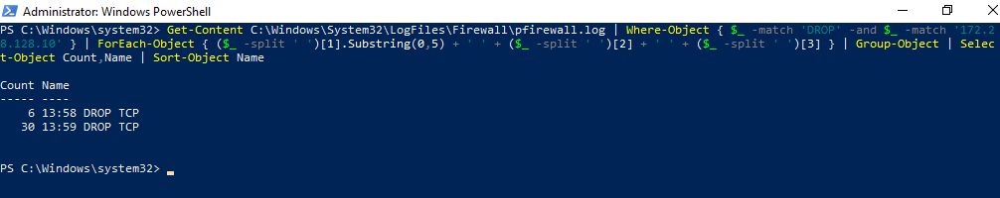
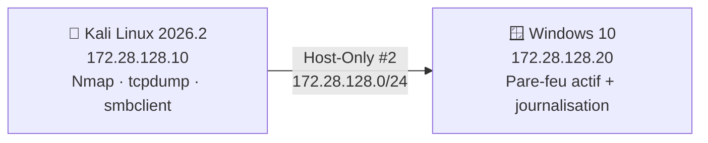

# 🪟 TP4 — Énumération Windows et évasion contrôlée (Nmap)


> **EN —** Controlled enumeration of a Windows 10 VM behind its **Windows Defender Firewall** (kept enabled), then measurement of what each scan technique leaves behind: ACK/Window, FIN/NULL/Xmas, timing, fragmentation, source port, decoys, SMB/RDP/WinRM NSE checks, `tcpdump` captures and **firewall log correlation**. 28 documented steps, 30 terminal screenshots, 32-page report.

Travaux pratiques du module **Ethical Hacking** — EMSI, 3ᵉ année du cycle ingénieur (5IIR).

<p align="center"></p>
<p align="center"><sub>Corrélation côté cible : ce que le pare-feu Windows a réellement journalisé pendant les scans.</sub></p>

## 🎯 Ce que démontre ce projet

| Compétence | Preuve dans le dépôt |
|---|---|
| Lecture du comportement d'un **pare-feu** | Tous les ports `filtered` (profil Public) ; différence `closed` / `filtered` / `open\|filtered` |
| Scans TCP alternatifs | ACK, Window, FIN, NULL, Xmas : ce que chacun mesure, et pourquoi ils sont peu fiables contre Windows |
| **Évasion contrôlée** et ses limites | Temporisation, fragmentation (`-f`, `--mtu 24`), port source 53, leurres : effet réel mesuré |
| Énumération Windows **non intrusive** | Scripts NSE SMB, `smbclient`, `enum4linux`, RDP (3389) et WinRM (5985/5986) |
| **Observation défensive** | Captures `tcpdump` par technique et **journal du pare-feu Windows** (`pfirewall.log`) |
| Esprit critique | Aucun scan ne rend le pentester « invisible » ; l'évasion ne contourne pas un pare-feu qui rejette tout |

## 🧪 Résultats clés

| Mesure | Résultat |
|---|---|
| Ports visibles depuis Kali (profil Public) | **0** : les 1 000 ports courants sont `filtered` |
| Ports réellement en écoute sur la cible | 135, 139, 445, 5040 (+ RPC dynamiques 49664–49669) ; **pas** de 3389 ni 5985 |
| FIN / NULL / Xmas | `open\|filtered` : ambigu, y compris sur des ports sans service |
| Temporisation (`-T2 --scan-delay 500ms`) | **21,4 s → 1 004,6 s** (×47) pour un résultat identique |
| Fragmentation, port source 53, leurres | Aucun changement de résultat : le pare-feu rejette tout de la même façon |
| Journal du pare-feu | SYN, scan lent, fragments, MTU 24, port source 53 et leurres **journalisés** ; ACK, Window, FIN, NULL, Xmas **non journalisés** |

> 💡 **Enseignement clé :** les techniques « discrètes » ne changent pas ce qu'un pare-feu bien configuré laisse voir, et plusieurs d'entre elles laissent une trace nette côté défenseur. Côté défense, la journalisation des connexions bloquées est indispensable.

## 🏗️ Architecture du laboratoire



Pare-feu Windows **laissé actif** (le TP commence par sa vérification, jamais par sa désactivation). Snapshots `avant-TP4` sur les deux machines.

## 📚 Les 28 étapes

Le guide complet — **objectif, commande exacte, capture, observation et analyse pour chaque étape** — est dans **[`docs/walkthrough.md`](docs/walkthrough.md)**.

| Partie | Contenu |
|---|---|
| 1 | Vérification de Windows et du pare-feu (configuration réseau, profils, règles) |
| 2 | Scan initial, découverte, détection de versions et de l'OS |
| 3 | Scans TCP alternatifs : ACK, Window, FIN, NULL, Xmas |
| 4 | Évasion contrôlée : temporisation, fragmentation, port source, leurres |
| 5 | Énumération NSE : identification des services, SMB non intrusif, RDP et WinRM |
| 6 | Observation et validation : `tcpdump`, journalisation du pare-feu, évaluation de la détectabilité |

📄 **Rapport complet (PDF, 32 pages)** : [`report/TP4_Rapport_Ethical_Hacking.pdf`](report/TP4_Rapport_Ethical_Hacking.pdf)

## 📁 Structure

```
├── README.md
├── docs/walkthrough.md      # guide pas-à-pas détaillé (28 étapes, 30 captures)
├── assets/                  # captures de terminal
├── report/                  # rapport PDF
└── automation/vm.ps1        # saisie de commandes et capture d'écran des VM via VBoxManage
```

## ⚖️ Cadre éthique

Tout a été réalisé sur **deux machines virtuelles du laboratoire**, en réseau Host-Only isolé. Les leurres et techniques d'évasion ne sont employés qu'avec des adresses du laboratoire. Ne reproduisez ces techniques que sur des systèmes dont vous avez l'autorisation écrite.

## 👤 Auteur

**Omar Babba** — élève ingénieur en Ingénierie Informatique et Réseaux, EMSI (3ᵉ année, 5IIR), orienté cybersécurité.

Autres travaux de la série : [TP3 — Reconnaissance active avec Nmap](https://github.com/omarbabba779xx/ethical-hacking-tp3-nmap-active-recon) · [TP5 — Analyse de vulnérabilités](https://github.com/omarbabba779xx/ethical-hacking-tp5-vulnerability-analysis-nmap-nse)

## 📄 Licence

[MIT](LICENSE)
