## 1. Introduction et objectifs

Ce rapport documente la réalisation du **TP 4 « Énumération Windows et évasion contrôlée »** du module
**Ethical Hacking**. À partir d'une machine **Kali Linux**, l'objectif est de caractériser le filtrage d'une machine
**Windows 10** protégée par le pare-feu Microsoft Defender, de comparer plusieurs techniques de scan, d'énumérer les services
accessibles avec Nmap et NSE, puis de confronter les observations aux journaux du pare-feu. Le but est d'évaluer les défenses,
sans exploitation.

Chaque étape du rapport donne : l'objectif, la commande exécutée, la capture d'écran du terminal correspondant, ce qui est
observé et l'analyse. Les captures prises pendant la réalisation sont toutes intégrées.

| Partie | Contenu | Résultat attendu |
|---|---|---|
| 1 | Vérification de Windows et du pare-feu | Identités réseau, profil actif, politique par défaut, ports en écoute |
| 2 | Scan initial et filtrage | Découverte, scan SYN, ports ciblés, versions et OS |
| 3 | Scans TCP alternatifs | ACK, Window, FIN, NULL, Xmas comparés au SYN |
| 4 | Techniques d'évasion contrôlées | Temporisation, fragmentation, port source, leurres |
| 5 | Énumération Windows avec NSE | Services, SMB, RDP et WinRM sans scripts intrusifs |
| 6 | Observation et validation | Capture réseau et journal du pare-feu Windows |

> ⚠️ **Cadre éthique et légal**
>
> Toutes les manipulations sont limitées aux machines virtuelles du laboratoire. Le réseau est en mode **Host-Only**, sans accès Internet. Aucun scan du réseau de l'établissement, d'Internet ou d'un équipement tiers n'a été effectué. Aucune exploitation, force brute, persistance ou déni de service n'a été réalisé, et les catégories NSE `brute`, `exploit` et `dos` n'ont pas été utilisées. Aucun identifiant n'a été testé.

## 2. Environnement et architecture du laboratoire

Le laboratoire repose sur **VirtualBox 7.2.8** (hôte Windows 11). Les deux machines virtuelles sont reliées par le réseau
**Host-Only #2** (172.28.128.0/24), sans serveur DHCP et sans passerelle. Aucune carte NAT ou pont n'est attachée.

| Rôle | Machine | Système | Configuration |
|---|---|---|---|
| Machine de pentest | kali-linux-2026.2-virtualbox-amd64 | Kali Linux 2026.2 | 2 Go de RAM, une carte Host-Only #2 |
| Cible autorisée | VM-Ethical-Hacking-Win10 | Windows 10 (64 bits) | 4 Go de RAM, 2 vCPU, une carte Host-Only #2 |

#### Mesures de sécurité prises avant le TP

- **Aucune carte NAT** : la machine Windows possédait une carte NAT et une carte Host-Only sur un autre réseau (#3). La carte NAT a été retirée et la carte Host-Only
a été rattachée au réseau #2, celui de Kali.

- **Snapshots** : un snapshot « avant-TP4 » a été pris sur chacune des deux machines avant toute manipulation.

- **Pare-feu Windows laissé actif** : conformément au sujet, le TP commence par sa vérification et jamais par sa désactivation.

- **Adresses IP** : le réseau n'a pas de DHCP ; Windows reçoit donc l'adresse fixe 172.28.128.20/24 et Kali garde 172.28.128.10/24.

#### Préparation de Kali

### 🔹 Étape 1 — Créer l'arborescence de travail et vérifier les outils

*Objectif : disposer des dossiers demandés, d'un journal horodaté et des outils nécessaires au TP.*

```bash
mkdir -p ~/tp4-windows/{profil,scans,evasion,nse,smb,traces,rapport}
cd ~/tp4-windows
date -Iseconds | tee rapport/journal.txt
for t in nmap smbclient enum4linux-ng tcpdump wireshark zip; do command -v $t; done
nmap --version | head -1
```

<p align="center">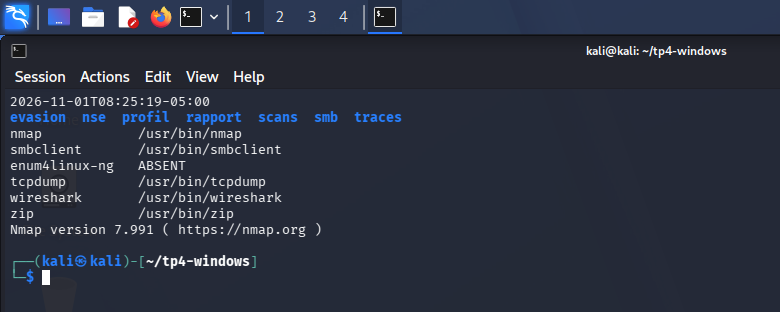</p>
<p align="center"><sub><b>Figure 1</b> — Préparation de Kali : sept dossiers, journal horodaté et outils présents (Nmap 7.991).</sub></p>

> ℹ️ **Remarque**
>
> L'étape `sudo apt update` / `apt install` du sujet n'a pas été exécutée : le réseau est isolé, donc sans Internet. Les outils étaient déjà installés, à l'exception de `enum4linux-ng` (voir la section 3 et l'exercice 5.2).

## 3. Méthodologie de réalisation et de capture

Les commandes sont celles du sujet. Pour garantir des captures homogènes, elles ont été saisies dans les terminaux des deux machines depuis l'hôte avec
l'outil `VBoxManage` (saisie clavier à distance), et l'écran de chaque machine a été capturé juste après
(`VBoxManage controlvm … screenshotpng`). Les mots de passe (`sudo`, session) ont été saisis par l'étudiant. Chaque capture montre uniquement un terminal.

| Écart avec le sujet | Raison | Effet |
|---|---|---|
| `-n` ajouté aux commandes `nmap` | Nmap 7.991 plante (`massdns.cc: Assertion failed`) quand aucun serveur DNS n'est joignable, ce qui est normal sans Internet. | Pas de résolution DNS inverse ; aucun effet sur les résultats. |
| Sorties d'`nmap` réduites avec `sed -n` dans les captures | Pour que le résultat tienne dans une capture lisible. | Les fichiers `-oN` contiennent la sortie complète. |
| `Select-Object -First 25` ajouté à `Get-NetFirewallRule` | La liste des règles entrantes est très longue. | Seules les 25 premières règles sont montrées. |
| `enum4linux` à la place d'`enum4linux-ng` | `enum4linux-ng` n'est pas installé et ne peut pas l'être sans Internet ; l'ancien `enum4linux` était présent. | Même objectif d'énumération SMB (voir 8.2). |
| Un fichier `.pcap` par technique, sur 5 ports (6.1) | Le sujet demande un scan à la fois dans la capture ; le scan lent est limité à 3 ports pour garder une durée raisonnable. | Volumes comparables entre techniques (Table 6). |
| Clavier Windows : QWERTY britannique | La saisie à distance a dû corriger les touches `\ \| # ~ " @` (scancodes bruts). | Aucun effet sur les résultats. |

> ℹ️ **Remarque sur les signes « + » du sujet**
>
> Dans le PDF du sujet, des signes « + » apparaissent au milieu de certaines commandes (par exemple `IP_WINDOWS +  -oN`). Ce sont des marques de césure ; ils n'ont pas été saisis.

## 4. Partie 1 — Vérification de Windows et du pare-feu

### 4.1. Exercice 1.1 : identifier la configuration réseau

### 🔹 Étape 1 — Poser l'adresse IP de Windows

*Objectif : placer la cible dans le réseau de Kali (pas de DHCP). Étape préalable, absente du sujet car l'IP y est « à relever ».*

```powershell
Set-NetIPInterface -InterfaceAlias 'Ethernet 2' -Dhcp Disabled
New-NetIPAddress -InterfaceAlias 'Ethernet 2' -IPAddress 172.28.128.20 -PrefixLength 24
```

<p align="center">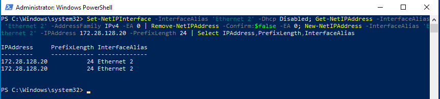</p>
<p align="center"><sub><b>Figure 2</b> — Adresse 172.28.128.20/24 appliquée à la carte « Ethernet 2 » (l'affichage est en double : configuration active et persistante).</sub></p>

### 🔹 Étape 2 — Relever la configuration réseau de Windows

*Objectif : connaître l'IP, la MAC et l'absence de passerelle (PowerShell en administrateur).*

```bash
ipconfig /all
```

<p align="center">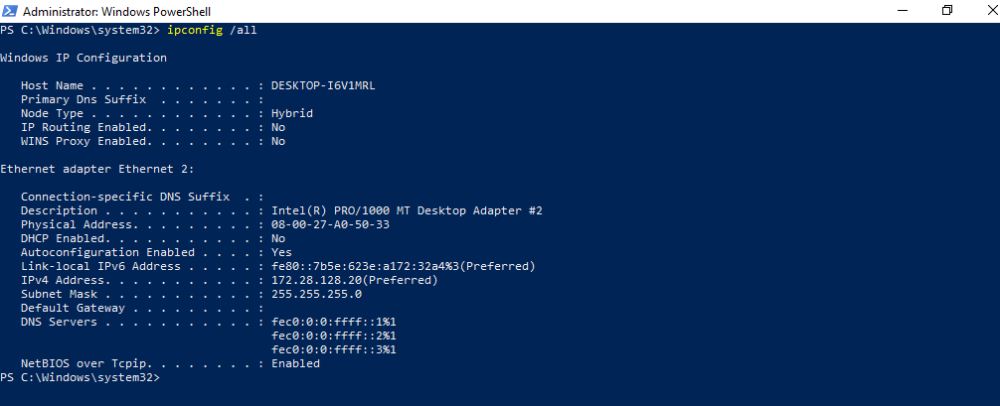</p>
<p align="center"><sub><b>Figure 3</b> — <code>ipconfig /all</code> : Ethernet 2, MAC 08-00-27-A0-50-33, IPv4 172.28.128.20, DHCP désactivé, aucune passerelle.</sub></p>

### 🔹 Étape 3 — Identifier le profil réseau actif

*Objectif : savoir quel profil du pare-feu s'applique (Domain, Private ou Public).*

```powershell
Get-NetConnectionProfile
```

<p align="center">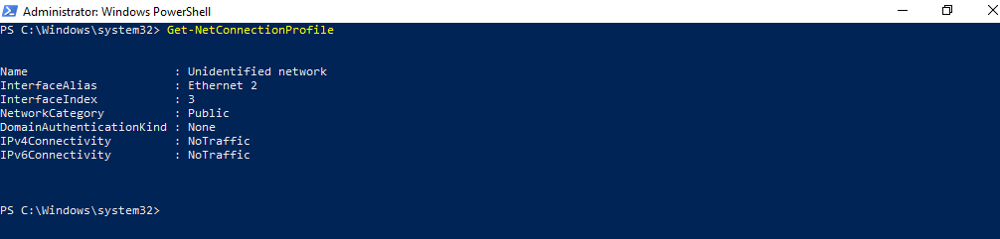</p>
<p align="center"><sub><b>Figure 4</b> — <code>Get-NetConnectionProfile</code> : réseau non identifié, catégorie <b>Public</b>.</sub></p>

### 🔹 Étape 4 — Lister les ports en écoute sur Windows

*Objectif : connaître les services locaux à comparer ensuite avec ce que Kali voit.*

```powershell
Get-NetTCPConnection -State Listen | Select-Object LocalAddress,LocalPort,OwningProcess | Sort-Object LocalPort
```

<p align="center">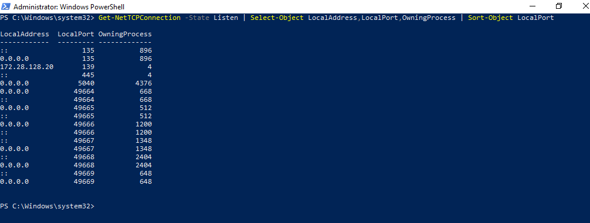</p>
<p align="center"><sub><b>Figure 5</b> — Ports en écoute : 135 (RPC), 139 (NetBIOS), 445 (SMB), 5040 et plusieurs ports RPC dynamiques (49664 à 49669). Aucun port 3389 ni 5985.</sub></p>

### 🔹 Étape 5 — Relever l'identité réseau de Kali et tester la connectivité

*Objectif : relever l'IP et la MAC de Kali et tester l'accès à la cible.*

```bash
ip -br address
ip route
ip link show eth0 | grep link/ether
ping -c 4 172.28.128.20
```

<p align="center">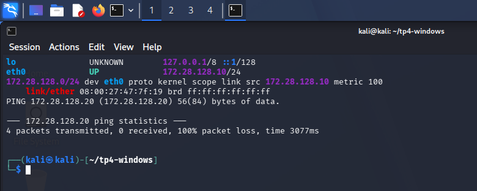</p>
<p align="center"><sub><b>Figure 6</b> — Kali : <code>eth0</code> 172.28.128.10/24, MAC 08:00:27:47:7f:19, une seule route. Le ping vers Windows reste sans réponse (100 % de perte).</sub></p>

### 🔹 Étape 6 — Vérifier la résolution ARP

*Objectif : distinguer un problème de réseau d'un filtrage du pare-feu.*

```bash
ip neigh show dev eth0
```

<p align="center">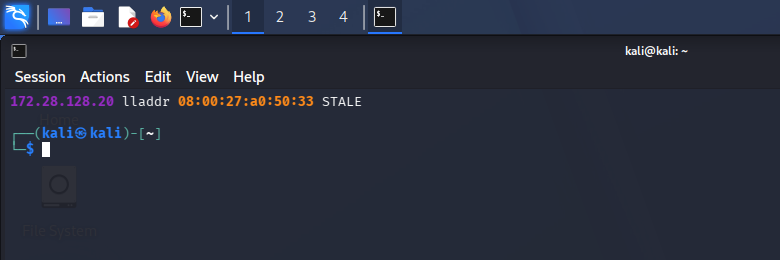</p>
<p align="center"><sub><b>Figure 7</b> — L'adresse 172.28.128.20 est résolue en 08:00:27:a0:50:33 : la couche 2 fonctionne, seul l'ICMP est bloqué.</sub></p>

| Machine | Interface | Adresse IP | Adresse MAC |
|---|---|---|---|
| Kali Linux | eth0 | 172.28.128.10/24 | 08:00:27:47:7F:19 |
| Windows 10 | Ethernet 2 | 172.28.128.20/24 | 08:00:27:A0:50:33 |

<p align="center"><sub><i>Table 3 — Identités réseau</i></sub></p>

> 🔎 **Analyse**
>
> Le ping échoue alors que l'ARP aboutit : la machine est joignable au niveau Ethernet, mais le pare-feu Windows (profil Public) ne répond pas aux requêtes ICMP. Windows écoute localement sur 135, 139 et 445 ; il n'écoute pas sur 3389 (RDP) ni 5985 (WinRM), ces services n'étant pas activés.

### 4.2. Exercice 1.2 : vérifier le pare-feu

### 🔹 Étape 7 — Lire les profils du pare-feu

*Objectif : vérifier l'état et la politique par défaut de chaque profil.*

```powershell
Get-NetFirewallProfile | Select-Object Name,Enabled,DefaultInboundAction,DefaultOutboundAction
```

<p align="center">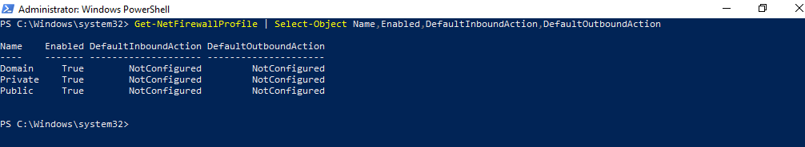</p>
<p align="center"><sub><b>Figure 8</b> — Les trois profils (Domain, Private, Public) sont activés ; les actions par défaut sont « NotConfigured » (valeurs par défaut de Windows).</sub></p>

### 🔹 Étape 8 — Lister les règles entrantes actives

*Objectif : voir quelles règles autorisent du trafic entrant (liste limitée aux 25 premières).*

```powershell
Get-NetFirewallRule -Enabled True -Direction Inbound | Select-Object DisplayName,Action,Profile | Select-Object -First 25
```

<p align="center">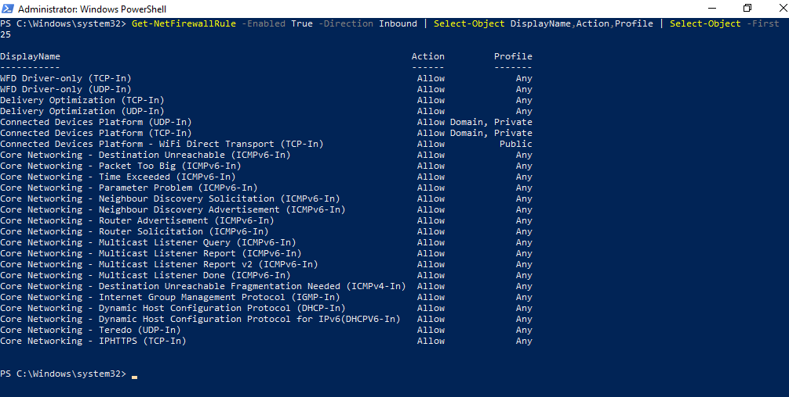</p>
<p align="center"><sub><b>Figure 9</b> — Règles entrantes actives : toutes en « Allow » (WFD, Delivery Optimization, Connected Devices, Core Networking…) ; aucune ne vise 135, 139, 445, 3389 ou 5985 parmi les 25 premières.</sub></p>

> 🔎 **Réponses aux questions de l'exercice 1.2**
>
> - **Profil actif :** **Public** (`NetworkCategory : Public`).
>
> - **Pare-feu activé :** oui, `Enabled = True` pour Domain, Private et Public.
>
> - **Politique entrante par défaut :** « NotConfigured », c'est-à-dire la valeur par défaut de Windows : le trafic entrant est bloqué sauf règle d'autorisation (confirmé par les scans de la partie 2).
>
> - **Port en écoute invisible :** un port en écoute signifie seulement qu'un service attend des connexions localement ; le pare-feu décide si les paquets arrivent jusqu'à lui. Ici 135, 139 et 445 écoutent mais sont filtrés.

## 5. Partie 2 — Scan initial et filtrage

### 5.1. Exercice 2.1 : découverte et ports courants

### 🔹 Étape 9 — Découvrir les hôtes du réseau

*Objectif : confirmer les machines actives dans 172.28.128.0/24.*

```bash
nmap -n -sn 172.28.128.0/24 -oN scans/decouverte.txt
```

<p align="center">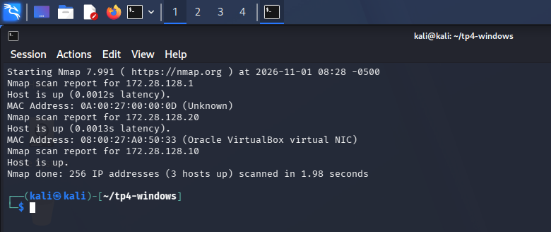</p>
<p align="center"><sub><b>Figure 10</b> — Découverte : 3 hôtes actifs sur 256 adresses — 172.28.128.1 (adaptateur Host-Only de l'hôte), 172.28.128.20 (Windows) et Kali.</sub></p>

### 🔹 Étape 10 — Lancer le scan SYN initial

*Objectif : voir comment Windows répond sur les 1000 ports les plus courants.*

```bash
sudo nmap -n -sS 172.28.128.20 -oN scans/syn-initial.txt
```

<p align="center">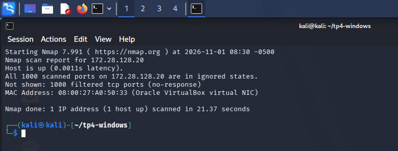</p>
<p align="center"><sub><b>Figure 11</b> — Scan SYN initial : les <b>1000 ports</b> sont <code>filtered</code> (aucune réponse) ; durée 21,4 s.</sub></p>

### 🔹 Étape 11 — Scanner les services Windows ciblés

*Objectif : renseigner la Table 4 pour 135, 139, 445, 3389 et 5985.*

```bash
sudo nmap -n -sS -p 135,139,445,3389,5985 172.28.128.20 -oN scans/ports-windows.txt
```

<p align="center">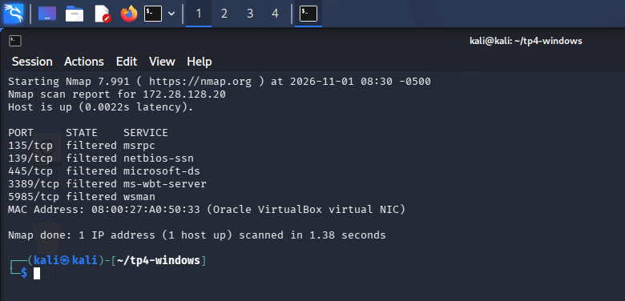</p>
<p align="center"><sub><b>Figure 12</b> — Ports ciblés : les cinq ports sont <code>filtered</code>.</sub></p>

| Port | État | Service probable | Observation |
|---|---|---|---|
| 135 | filtered | RPC (msrpc) | Écoute locale (Get-NetTCPConnection), mais aucun paquet de réponse depuis Kali |
| 139 | filtered | NetBIOS (netbios-ssn) | Écoute locale sur 172.28.128.20 uniquement, filtré |
| 445 | filtered | SMB (microsoft-ds) | Écoute locale, filtré : l'énumération SMB anonyme est impossible |
| 3389 | filtered | RDP (ms-wbt-server) | Pas d'écoute locale : service absent, mais indiscernable d'un port filtré |
| 5985 | filtered | WinRM (wsman) | Pas d'écoute locale : service absent, mais indiscernable d'un port filtré |

<p align="center"><sub><i>Table 4 — Services Windows ciblés</i></sub></p>

### 5.2. Exercice 2.2 : détection des versions et de l'OS

### 🔹 Étape 12 — Détecter les versions et le système

*Objectif : comparer ce qu'Nmap voit avec les ports en écoute sur Windows.*

```bash
sudo nmap -n -sS -sV -O 172.28.128.20 -oN scans/services-os.txt
```

<p align="center">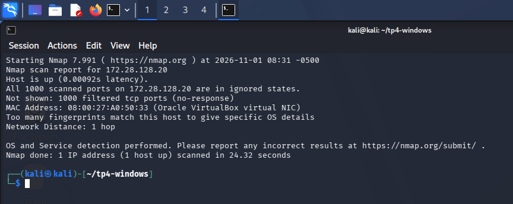</p>
<p align="center"><sub><b>Figure 13</b> — <code>-sV -O</code> : aucun port ouvert, donc aucune version ; Nmap indique « Too many fingerprints match this host » et une distance d'un saut.</sub></p>

> 🔎 **Analyse**
>
> Le sujet attend que l'on distingue un service absent, un port fermé et un service localement actif mais filtré. Dans ce laboratoire, le profil Public rejette tout le trafic entrant **sans réponse** : les services actifs (135, 139, 445) et les services absents (3389, 5985) apparaissent **identiquement** `filtered`. Aucun port `closed` n'a pu être observé, car un port fermé suppose un paquet RST renvoyé, ce que le pare-feu empêche. Le filtrage silencieux masque donc la différence entre « absent » et « protégé ».

## 6. Partie 3 — Scans TCP alternatifs

### 6.1. Exercice 3.1 : ACK et Window Scan

### 🔹 Étape 13 — Lancer les scans ACK et Window

*Objectif : tester si le filtrage est sans état (stateless) ou avec état (stateful).*

```bash
sudo nmap -n -sA -p 135,139,445,3389,5985 172.28.128.20 -oN evasion/ack.txt
sudo nmap -n -sW -p 135,139,445,3389,5985 172.28.128.20 -oN evasion/window.txt
```

<p align="center">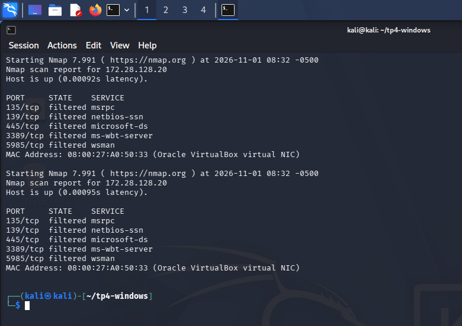</p>
<p align="center"><sub><b>Figure 14</b> — ACK puis Window : les cinq ports restent <code>filtered</code> dans les deux cas.</sub></p>

> 🔎 **Réponses aux questions de l'exercice 3.1**
>
> - **Ports filtered ou unfiltered :** tous les ports sont `filtered` ; aucun n'est `unfiltered`.
>
> - **ACK ne prouve pas qu'un port est ouvert :** un paquet ACK isolé ne crée pas de connexion ; une réponse RST indique seulement que le paquet a atteint la machine (`unfiltered`), que le port soit ouvert ou fermé.
>
> - **Filtrage stateful :** oui. Un pare-feu sans état laisserait passer un ACK ; ici le paquet, qui ne correspond à aucune connexion établie, est rejeté sans réponse.

### 6.2. Exercice 3.2 : FIN, NULL et Xmas

### 🔹 Étape 14 — Lancer les scans FIN, NULL et Xmas

*Objectif : comparer ces scans furtifs au scan SYN sur Windows.*

```bash
sudo nmap -n -sF -p 135,139,445,3389 172.28.128.20 -oN evasion/fin.txt
sudo nmap -n -sN -p 135,139,445,3389 172.28.128.20 -oN evasion/null.txt
sudo nmap -n -sX -p 135,139,445,3389 172.28.128.20 -oN evasion/xmas.txt
```

<p align="center">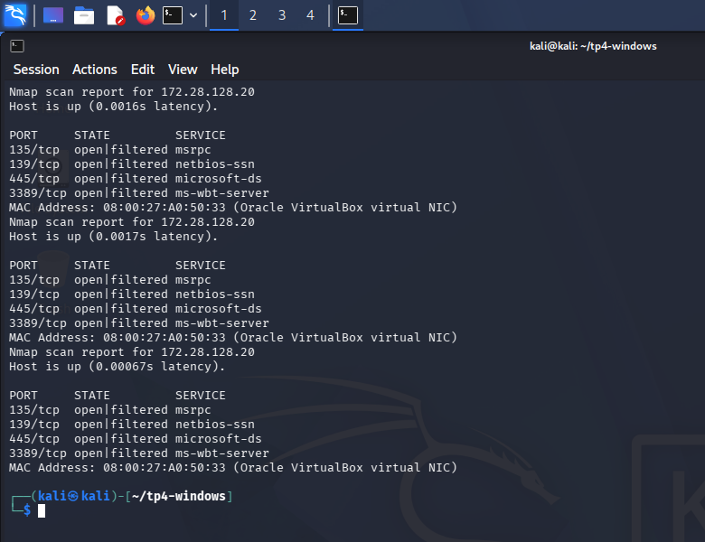</p>
<p align="center"><sub><b>Figure 15</b> — FIN, NULL et Xmas : les quatre ports sont <code>open|filtered</code> dans les trois scans.</sub></p>

| Scan | États observés | Information utile | Limite |
|---|---|---|---|
| SYN | filtered (5 ports) | Aucune réponse : paquets rejetés par le pare-feu | Ne distingue pas un port absent d'un port protégé |
| ACK | filtered (5 ports) | Pas de RST : filtrage avec état | Ne dit rien sur l'ouverture d'un port |
| Window | filtered (5 ports) | Même résultat que l'ACK | Utile surtout sur d'autres systèmes |
| FIN/NULL/Xmas | open\|filtered (4 ports) | Aucune réponse obtenue | Ambigu : absence de réponse = port ouvert *ou* filtré |

<p align="center"><sub><i>Table 5 — Comparaison des scans TCP</i></sub></p>

> 🔎 **Analyse**
>
> FIN, NULL et Xmas reposent sur la règle de la RFC 793 : un port fermé répond par un RST, un port ouvert se tait. Windows ne suit pas cette règle (il répond par un RST quelle que soit la situation lorsqu'aucun filtre ne s'interpose), et ici le pare-feu se tait pour tout. Le résultat `open|filtered` ne donne donc **aucune information fiable** : il est affiché y compris pour 3389, où aucun service n'écoute.

## 7. Partie 4 — Techniques d'évasion contrôlées

### 7.1. Exercice 4.1 : temporisation

### 🔹 Étape 15 — Scan normal (-T3)

*Objectif : mesurer la durée de référence sur les 1000 premiers ports.*

```bash
time sudo nmap -n -sS -T3 -p 1-1000 172.28.128.20 -oN evasion/normal.txt
```

<p align="center">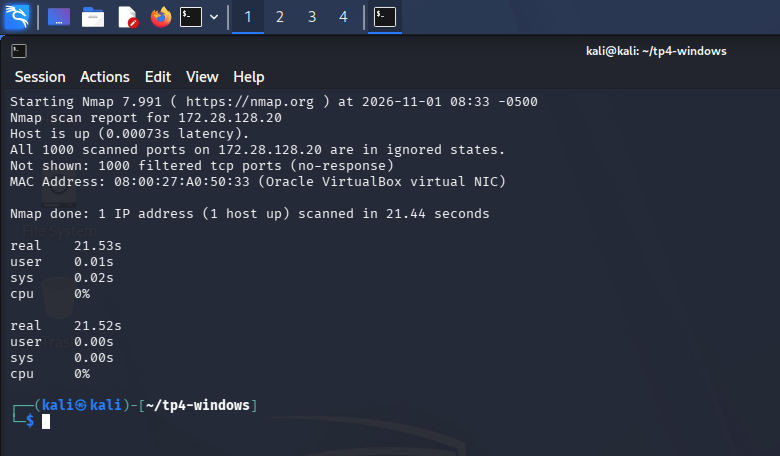</p>
<p align="center"><sub><b>Figure 16</b> — Scan normal : 1000 ports <code>filtered</code> en 21,4 s (21,5 s mesurés par <code>time</code>).</sub></p>

### 🔹 Étape 16 — Scan lent (-T2, délai de 500 ms)

*Objectif : mesurer l'effet de la temporisation sur la durée et sur les résultats.*

```bash
time sudo nmap -n -sS -T2 --scan-delay 500ms -p 1-1000 172.28.128.20 -oN evasion/lent.txt
```

<p align="center">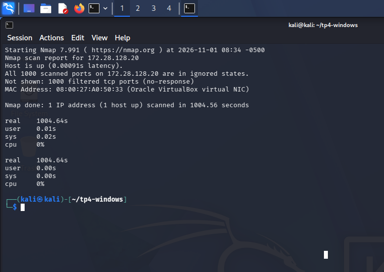</p>
<p align="center"><sub><b>Figure 17</b> — Scan lent : même résultat (1000 ports <code>filtered</code>) mais en <b>1004,6 s</b>, soit environ 47 fois plus long.</sub></p>

> 🔎 **Analyse**
>
> La temporisation ne change pas les résultats, seulement la durée : 21,4 s contre 1004,6 s. Un scan lent réduit le débit, mais chaque sonde reste enregistrée (voir 9.3) ; il demeure donc corrélable dans les journaux.

### 7.2. Exercice 4.2 : fragmentation

### 🔹 Étape 17 — Fragmenter les paquets

*Objectif : tester si la fragmentation modifie le résultat ou traverse le pare-feu.*

```bash
sudo nmap -n -sS -f -p 135,139,445,3389 172.28.128.20 -oN evasion/fragments.txt
sudo nmap -n -sS --mtu 24 -p 135,139,445,3389 172.28.128.20 -oN evasion/mtu24.txt
```

<p align="center">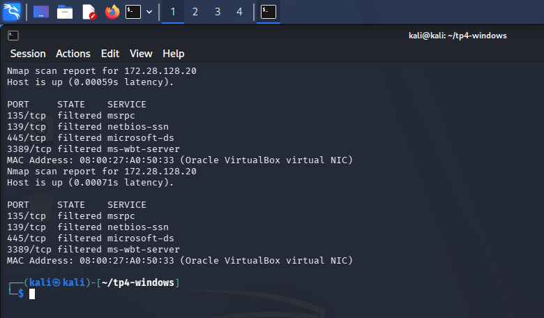</p>
<p align="center"><sub><b>Figure 18</b> — Fragmentation (<code>-f</code> puis <code>--mtu 24</code>) : les quatre ports restent <code>filtered</code>.</sub></p>

> 🔎 **Réponses aux questions de l'exercice 4.2**
>
> - **Différence avec le SYN initial :** aucune ; tous les ports restent `filtered`.
>
> - **Fragments visibles :** la capture `frag.pcap` contient 32 paquets contre 12 pour un scan SYN simple (voir 9.1) : les sondes sont découpées en plusieurs fragments. Avec `--mtu 24`, la capture ne contient que 12 paquets : l'en-tête TCP de 20 octets tient dans la taille demandée et n'est pas découpé.
>
> - **Réassemblage ou blocage :** le pare-feu bloque : les fragments sont enregistrés comme paquets rejetés dans le journal (voir 9.3) et aucun port n'apparaît ouvert.

### 7.3. Exercice 4.3 : port source

### 7.4. Exercice 4.4 : leurres réservés au laboratoire

### 🔹 Étape 18 — Port source 53 et leurres

*Objectif : tester une règle faible fondée sur le port source, puis deux leurres privés non attribués (172.28.128.50 et 172.28.128.60).*

```bash
sudo nmap -n -sS --source-port 53 -p 135,139,445,3389 172.28.128.20 -oN evasion/source53.txt
sudo nmap -n -sS -D 172.28.128.50,ME,172.28.128.60 -p 135,139,445,3389 172.28.128.20 -oN evasion/decoys.txt
```

<p align="center">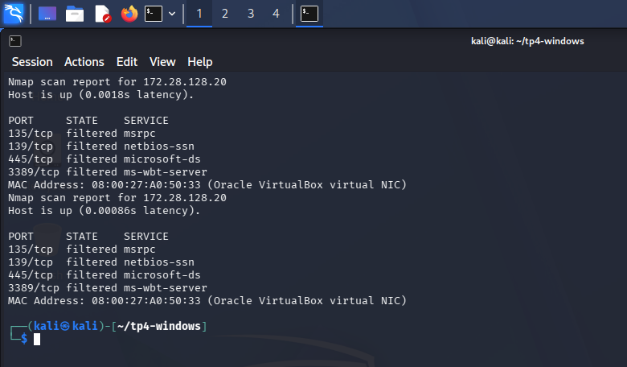</p>
<p align="center"><sub><b>Figure 19</b> — Port source 53 puis leurres : les quatre ports restent <code>filtered</code> dans les deux scans.</sub></p>

> 🔎 **Analyse**
>
> Le port source 53 n'a eu aucune influence : le pare-feu Windows est avec état et ne se fonde pas sur le port source. Les leurres n'ont pas modifié non plus le résultat. Les deux adresses de leurre sont privées, dans le réseau isolé et non attribuées, comme l'exige le sujet ; l'adresse réelle de Kali reste présente dans le trafic et dans les journaux.

## 8. Partie 5 — Énumération Windows avec NSE

### 8.1. Exercice 5.1 : identification des services

### 🔹 Étape 19 — Scripts par défaut et versions

*Objectif : identifier les services avec les scripts NSE de la catégorie `default`.*

```bash
sudo nmap -n -sV -sC -p 135,139,445,3389,5985 172.28.128.20 -oN nse/default.txt
```

### 8.2. Exercice 5.2 : énumération SMB non intrusive

### 🔹 Étape 20 — Scripts SMB

*Objectif : relever les protocoles SMB, la signature et l'heure du serveur.*

```bash
sudo nmap -n -p 139,445 --script smb-protocols,smb2-security-mode,smb2-time 172.28.128.20 -oN nse/smb.txt
```

<p align="center">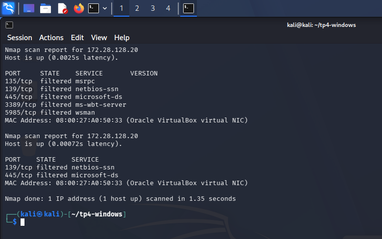</p>
<p align="center"><sub><b>Figure 20</b> — Scripts par défaut puis scripts SMB : cinq ports <code>filtered</code>, aucune version et aucun résultat de script.</sub></p>

### 🔹 Étape 21 — Partages anonymes et énumération SMB

*Objectif : lister les partages visibles sans authentification et le domaine ou groupe de travail.*

```bash
smbclient -L //172.28.128.20 -N | tee smb/partages-anonymes.txt
enum4linux -a 172.28.128.20 | tee smb/enum4linux.txt
```

<p align="center">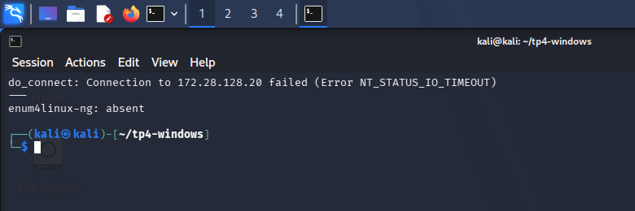</p>
<p align="center"><sub><b>Figure 21</b> — <code>smbclient -L</code> : « Connection failed (NT_STATUS_IO_TIMEOUT) » ; <code>enum4linux-ng</code> est absent.</sub></p>

<p align="center">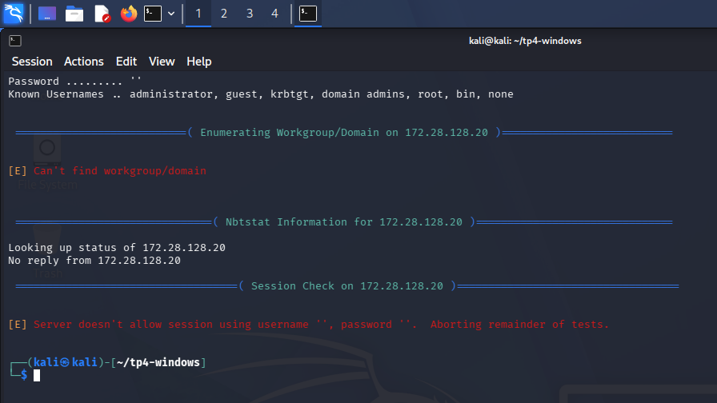</p>
<p align="center"><sub><b>Figure 22</b> — <code>enum4linux -a</code> : « Can't find workgroup/domain », aucune réponse NetBIOS, et « Server doesn't allow session using username '', password '' » : les tests suivants sont abandonnés.</sub></p>

> ℹ️ **Résultat**
>
> Aucune version de SMB, aucune information de signature, aucun partage visible et aucun domaine n'ont pu être relevés. Comme l'indique le sujet, un refus d'accès est un résultat pertinent : il confirme que l'énumération anonyme est impossible et que les ports SMB sont filtrés.

### 8.3. Exercice 5.3 : RDP et WinRM

### 🔹 Étape 22 — Énumération RDP et WinRM

*Objectif : relever le chiffrement RDP et la version du service WinRM, sans aucun script `brute`, `exploit` ou `dos`.*

```bash
sudo nmap -n -sV -p 3389 --script rdp-enum-encryption 172.28.128.20 -oN nse/rdp.txt
sudo nmap -n -sV -p 5985,5986 172.28.128.20 -oN nse/winrm.txt
```

<p align="center">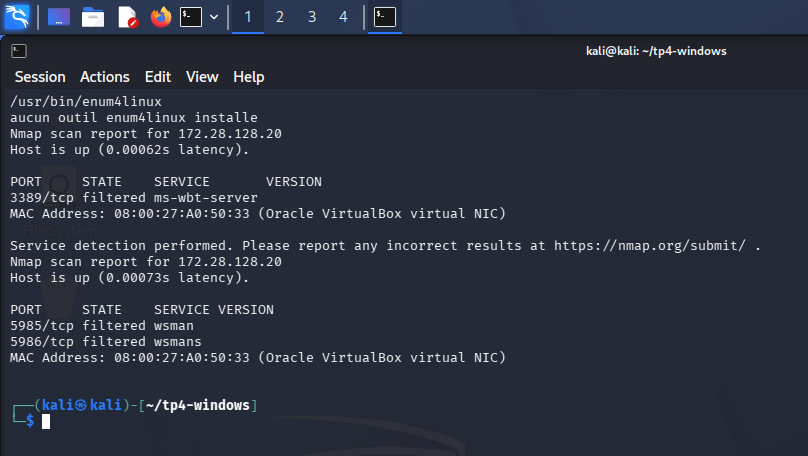</p>
<p align="center"><sub><b>Figure 23</b> — RDP (3389), WinRM (5985) et WinRM sécurisé (5986) : tous <code>filtered</code>, aucun résultat de script.</sub></p>

## 9. Partie 6 — Observation et validation

### 9.1. Exercice 6.1 : capture avec tcpdump

### 🔹 Étape 23 — Activer la journalisation du pare-feu (préalable)

*Objectif : pouvoir retrouver dans le journal Windows les scans relancés pour la capture (exercice 6.2, effectué avant 6.1).*

```powershell
Set-NetFirewallProfile -Profile Public,Private -LogAllowed True -LogBlocked True
Get-NetFirewallProfile -Profile Public,Private | Select-Object Name,LogAllowed,LogBlocked,LogFileName
```

<p align="center">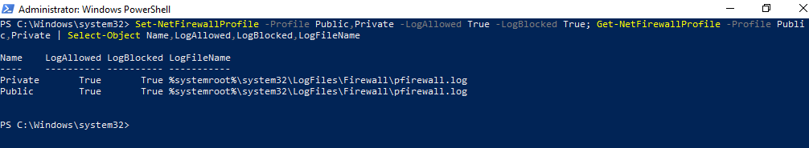</p>
<p align="center"><sub><b>Figure 24</b> — Journalisation activée sur les profils Public et Private : fichier <code>%systemroot%\system32\LogFiles\Firewall\pfirewall.log</code>.</sub></p>

### 🔹 Étape 24 — Capturer chaque technique séparément

*Objectif : un fichier `.pcap` par scan, avec l'heure notée (un seul scan à la fois, puis arrêt de la capture).*

```bash
cap(){ n=$1; shift; sudo tcpdump -n -i eth0 host 172.28.128.20 -w traces/$n.pcap >/dev/null 2>&1 & sleep 2; printf '%s  %s\n' $(date +%T) $n; sudo "$@" >/dev/null 2>&1; sleep 2; sudo pkill -f 'tcpdump -n -i eth0'; sleep 1; }
P=135,139,445,3389,5985; T=172.28.128.20
cap syn nmap -n -sS -p $P $T      # idem : ack (-sA), window (-sW), fin (-sF), null (-sN), xmas (-sX)
cap lent nmap -n -sS -T2 --scan-delay 500ms -p 135,139,445 $T
cap frag nmap -n -sS -f -p $P $T      # idem : mtu24 (--mtu 24), source53 (--source-port 53), leurres (-D ...)
```

<p align="center">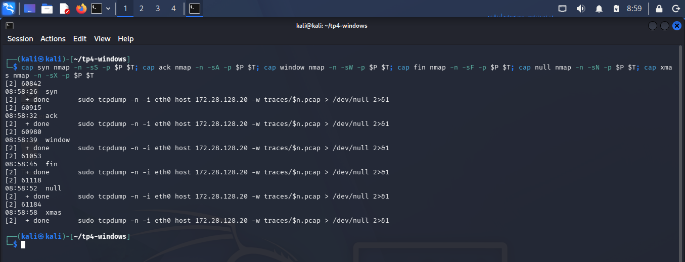</p>
<p align="center"><sub><b>Figure 25</b> — Heures de début des six premières captures (08:58:26 à 08:58:58). Les suivantes : lent 08:59:46, frag 08:59:57, mtu24 09:00:03, source53 09:00:10, leurres 09:00:16.</sub></p>

<p align="center">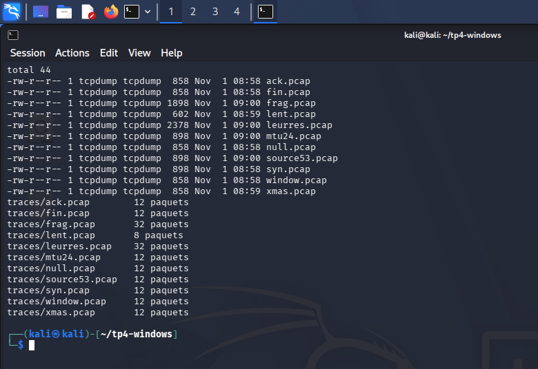</p>
<p align="center"><sub><b>Figure 26</b> — Dix fichiers <code>.pcap</code> et leur nombre de paquets : 12 pour les scans simples, 8 pour le scan lent (3 ports), 32 pour la fragmentation et pour les leurres.</sub></p>

| Technique | Heure (Kali) | Paquets capturés | Lecture |
|---|---|---|---|
| SYN, ACK, Window, FIN, NULL, Xmas | 08:58:26 – 08:58:58 | 12 chacun | 5 ports × 2 essais = 10 sondes, plus 2 échanges ARP ; aucune réponse de la cible |
| Scan lent (3 ports) | 08:59:46 | 8 | 6 sondes espacées de 500 ms, plus ARP |
| Fragmentation (-f) | 08:59:57 | 32 | Chaque sonde est découpée en fragments : 20 paquets de plus qu'un SYN simple |
| --mtu 24 | 09:00:03 | 12 | Identique au SYN : l'en-tête TCP (20 octets) n'est pas fragmenté |
| Port source 53 | 09:00:10 | 12 | Mêmes paquets, avec le port source 53 |
| Leurres (-D) | 09:00:16 | 32 | Les sondes sont émises avec trois adresses sources (3 × 10, plus ARP) |

<p align="center"><sub><i>Table 6 — Volume de paquets par technique</i></sub></p>

### 9.2. Exercice 6.2 : journalisation du pare-feu Windows

### 🔹 Étape 25 — Lire le journal du pare-feu

*Objectif : retrouver les scans dans `pfirewall.log` (extrait des 16 dernières lignes).*

```powershell
Get-Content C:\Windows\System32\LogFiles\Firewall\pfirewall.log | Select-Object -Last 16
```

<p align="center">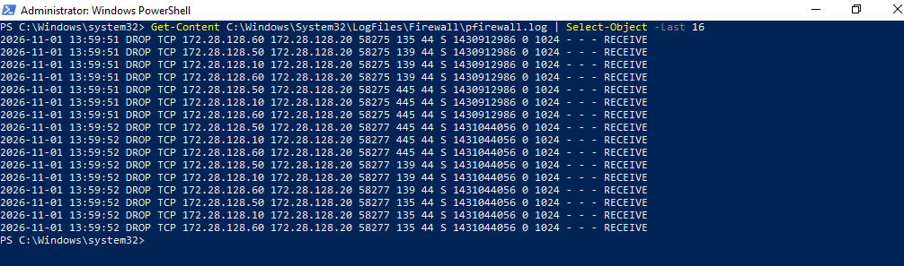</p>
<p align="center"><sub><b>Figure 27</b> — Dernières lignes du journal : paquets <code>DROP TCP</code> au drapeau <code>S</code> (SYN) vers les ports 135, 139 et 445, émis depuis <b>172.28.128.10</b> (Kali) et depuis les leurres <b>172.28.128.50</b> et <b>172.28.128.60</b>.</sub></p>

### 🔹 Étape 26 — Compter les entrées par minute

*Objectif : mesurer combien d'entrées le journal contient pour les scans de Kali.*

```powershell
Get-Content C:\Windows\System32\LogFiles\Firewall\pfirewall.log | Where-Object { $_ -match 'DROP' -and $_ -match '172.28.128.10' } | ForEach-Object { ($_ -split ' ')[1].Substring(0,5) + ' ' + ($_ -split ' ')[2] + ' ' + ($_ -split ' ')[3] } | Group-Object | Select-Object Count,Name | Sort-Object Name
```

<p align="center">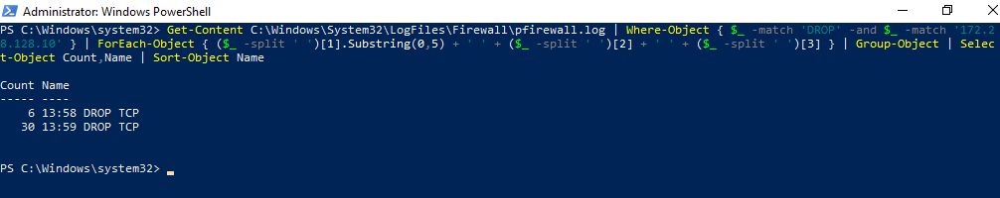</p>
<p align="center"><sub><b>Figure 28</b> — 36 paquets rejetés issus de Kali : 6 à 13:58 et 30 à 13:59.</sub></p>

### 🔹 Étape 27 — Détailler par seconde, source et drapeaux

*Objectif : associer chaque salve d'entrées à une technique grâce à l'heure.*

```powershell
Get-Content C:\Windows\System32\LogFiles\Firewall\pfirewall.log | Where-Object { $_ -match ' 172.28.128.(10|50|60) 172.28.128.20 ' } | ForEach-Object { $f = $_ -split ' '; $f[1].Substring(0,8) + ' ' + $f[2] + ' ' + $f[3] + ' src=' + $f[4].Split('.')[3] + ' flags=' + $f[9] } | Group-Object | Select-Object Count,Name | Format-Table -AutoSize
```

<p align="center">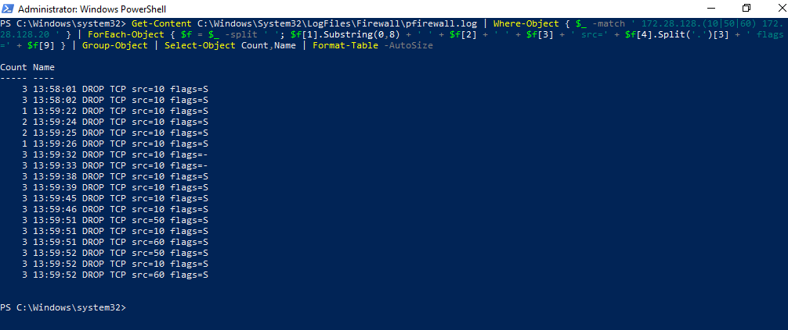</p>
<p align="center"><sub><b>Figure 29</b> — Détail par seconde : source (10, 50 ou 60) et drapeaux TCP (S ou « - » pour les fragments).</sub></p>

> ℹ️ **Décalage d'horloge**
>
> Les horloges des deux machines diffèrent d'environ 25 secondes : le scan SYN lancé à 08:58:26 sur Kali apparaît à 13:58:01 dans le journal Windows (les fuseaux horaires diffèrent aussi). La corrélation de la Table 7 tient compte de cet écart constant.

### 9.3. Évaluation du filtrage et de la détectabilité

| Technique | Résultat | Dans le journal ? | Conclusion |
|---|---|---|---|
| SYN | filtered | Oui : 6 entrées DROP (drapeau S) à 13:58:01–02 | Visible dans le journal |
| ACK / Window | filtered | **Non** : aucune entrée à 13:58:07 ni 13:58:14 | Paquets hors connexion rejetés sans journalisation |
| FIN / NULL / Xmas | open\|filtered | **Non** : aucune entrée entre 13:58:20 et 13:58:33 | Plus discrets dans le journal, mais sans information utile |
| Scan lent | filtered | Oui : 6 entrées étalées de 13:59:22 à 13:59:26 | Étalé dans le temps mais toujours corrélable |
| Fragmentation | filtered | Oui : 6 entrées DROP au drapeau « - » à 13:59:32–33 | Les fragments sont journalisés, sans drapeau TCP exploitable |
| --mtu 24 | filtered | Oui : 6 entrées DROP (drapeau S) à 13:59:38–39 | Se comporte comme un SYN ordinaire |
| Source 53 | filtered | Oui : 6 entrées DROP (drapeau S) à 13:59:45–46 | Aucun contournement ; visible |
| Leurres | filtered | Oui : 18 entrées, 6 par source (.10, .50 et .60) | L'adresse réelle de Kali figure dans le journal parmi les leurres |

<p align="center"><sub><i>Table 7 — Évaluation du filtrage et de la détectabilité</i></sub></p>

> 🔎 **Analyse**
>
> Chaque technique testée produit le même résultat côté scanner (`filtered` ou `open|filtered`), mais pas la même trace côté Windows. Les scans de type SYN, lents, fragmentés, à port source 53 ou à leurres laissent des entrées `DROP` dans le journal. Les scans ACK, Window, FIN, NULL et Xmas n'en laissent aucune dans ce journal : ils sont plus discrets, mais le trafic reste visible dans une capture réseau. Dans l'extrait affiché (scan à leurres), seuls les ports 135, 139 et 445, ceux qui écoutent, apparaissent ; 3389 et 5985 n'y figurent pas.

## 10. Réponses aux questions de synthèse

1. **Profil du pare-feu actif :** le profil **Public** (réseau non identifié, sans passerelle).

1. **Ports en écoute mais invisibles depuis Kali :** 135, 139 et 445, ainsi que 5040 et les ports RPC dynamiques (49664 à 49669) ; aucun port n'est visible depuis Kali.

1. **Différence entre closed et filtered :** `closed` signifie qu'un RST a été reçu (le paquet est arrivé, aucun service n'écoute) ; `filtered` signifie qu'aucune réponse n'est revenue (paquet rejeté). Seul `filtered` a été observé ici.

1. **ACK Scan et port ouvert :** non. Il ne mesure que le filtrage (`unfiltered` ou `filtered`), pas l'état ouvert ou fermé d'un port.

1. **FIN, NULL et Xmas peu fiables contre Windows :** Windows ne respecte pas le comportement de la RFC 793 et, ici, le pare-feu se tait : le résultat `open|filtered` est ambigu, y compris pour des ports où aucun service n'écoute.

1. **Effet de la temporisation :** uniquement sur la durée (21,4 s contre 1004,6 s) ; les résultats sont identiques.

1. **La fragmentation a-t-elle traversé le filtrage ?** Non : les ports restent `filtered` et les fragments sont journalisés comme paquets rejetés.

1. **Influence du port source 53 :** aucune : le pare-feu est avec état et ne fonde pas ses règles sur le port source.

1. **Informations obtenues avec NSE et SMB :** pratiquement aucune : ports filtrés, `smbclient` en délai dépassé et `enum4linux` sans session anonyme ni domaine. Seuls le fabricant de la carte (VirtualBox), la distance d'un saut et l'absence de correspondance d'OS ont été obtenus.

1. **Aucune technique ne garantit l'invisibilité :** même les techniques les plus discrètes laissent des traces (journal du pare-feu pour SYN, lent, fragmenté, port source et leurres ; capture réseau pour toutes). L'adresse de Kali reste présente, même avec des leurres.

## 11. Limites et réserves

- Aucun port `closed` ni `open` n'a pu être observé : le pare-feu en profil Public a filtré tous les ports. Les protocoles SMB, RDP et WinRM n'ont donc pas pu être énumérés.

- Les services RDP et WinRM ne sont pas activés sur cette machine Windows ; ils n'ont pas été activés pour le TP, afin de ne pas modifier la configuration de la cible au-delà de ce que demande le sujet (IP statique et journalisation du pare-feu).

- Le profil de la carte (Public) n'a pas été changé en Private ; une comparaison entre profils n'a pas été réalisée.

- La liste des règles entrantes est limitée aux 25 premières. Les captures ont été analysées par le nombre de paquets ; elles n'ont pas été ouvertes dans l'interface graphique de Wireshark.

- Le scan lent n'a été capturé que sur 3 ports, et la corrélation avec le journal suppose un décalage d'horloge constant d'environ 25 secondes entre les deux machines.

- Le dossier `profil/` de l'archive est vide : les sorties de la partie 1 côté Windows sont conservées sous forme de captures d'écran, pas de fichiers.

- Incidents rencontrés : une commande saisie pendant que `sudo` attendait le mot de passe n'a pas été exécutée (refaite ensuite) ; l'écran de Kali s'est verrouillé pendant le scan lent, sans interrompre le scan.

## 12. Conclusion générale

Le TP a permis de caractériser le filtrage d'une machine Windows 10 protégée par son pare-feu : le profil Public rejette sans réponse tout le trafic entrant, y compris vers les services qui écoutent localement (135, 139, 445),
et ne permet pas de distinguer un service absent (3389, 5985) d'un service protégé. Les scans ACK, Window, FIN, NULL et Xmas, la temporisation, la fragmentation, le port source et les leurres n'ont modifié aucun résultat : seuls la durée,
le volume de paquets et les traces ont changé.

La confrontation avec le journal du pare-feu montre que les scans SYN, lents, fragmentés, à port source 53 ou à leurres sont enregistrés, avec l'adresse réelle de Kali, tandis que les scans ACK, Window, FIN, NULL et Xmas ne le sont pas.
Aucune technique n'est donc invisible. Pour un auditeur, les techniques d'évasion apportent peu face à un pare-feu à états correctement configuré ; pour un défenseur, la journalisation et la corrélation avec une capture réseau restent les meilleurs outils de détection.

## Annexe — Livrables et archive

Le dossier `~/tp4-windows` de Kali est archivé comme demandé par le sujet. L'archive contient : le journal horodaté et l'historique des commandes, les résultats de tous les scans (découverte, SYN, évasion),
les sorties NSE et SMB, et les dix captures réseau `.pcap`.

```bash
cd ~/tp4-windows
fc -l 1 > rapport/historique-commandes.txt
date -Iseconds | tee -a rapport/journal.txt
cd ~
zip -r TP4_BABBA_OMAR.zip tp4-windows/
ls -l TP4_BABBA_OMAR.zip
unzip -l TP4_BABBA_OMAR.zip | tail -n 25
```

<p align="center">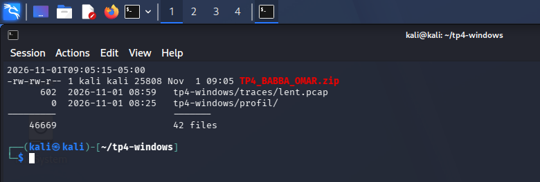</p>
<p align="center"><sub><b>Figure 30</b> — Archive <code>TP4_BABBA_OMAR.zip</code> : 25 808 octets, 42 fichiers.</sub></p>
